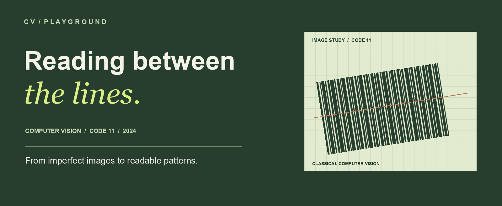
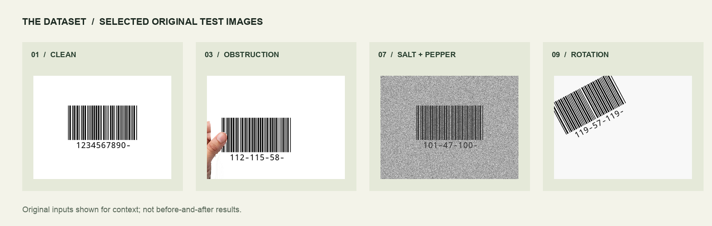
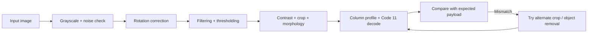

<p align="center">
  
</p>

# CV Playground

### Recovering barcode signals from difficult images

**CV Playground** is a computer vision coursework project that explores a deceptively demanding problem: reading a barcode when the image is blurred, noisy, rotated, low-contrast, or partially obstructed. Our team built and iterated on a classical image-processing pipeline to isolate the barcode and translate its visual pattern into Code 11 characters.

**Python · OpenCV · NumPy · SciPy · Matplotlib**

**Team project · Fall 2024 · 11 supplied test images**

[Explore the project story locally](index.html) · [Technical documentation](docs/PROJECT.md) · [Run the benchmark](#run-the-benchmark) · [Meet the team](#the-team)

> **Local benchmark:** the recovered variant matched **10 of 11** expected payloads. This is a known-answer benchmark: the expected answer is supplied to the retry logic. It is not a measure of accuracy on unseen barcodes. [See the result and limitations ↓](#results--limitations)

---

## The challenge

A barcode encodes information in the **relative widths of its bars and spaces**. Image quality changes the very signal we need to measure: blur merges edges, noise introduces false details, rotation disrupts the reading direction, and an obstruction can cover essential information. A correction that helps one image can make another worse.

<p align="center">
  
</p>
<p align="center"><sub>Selected original test images, shown as inputs rather than before-and-after results.</sub></p>

The supplied set also includes dark and bright low-contrast images, compression artifacts, blur, and a combined frequency-noise and rotation case. The goal was to make these different conditions manageable enough for the decoder to interpret the pattern.

## Our approach

Rather than relying on a single filter, the recovered pipeline combines multiple image-processing techniques. Each step addresses a different part of the problem, from aligning the image to interpreting bar widths.



| Stage | What the recovered variant does | Why it matters |
|:--|:--|:--|
| **1 · Prepare** | Converts to grayscale and checks FFT magnitude peaks for periodic noise; conditionally applies adaptive thresholding. | Reduces color complexity and attempts to handle structured interference. |
| **2 · Align** | Estimates orientation from edges and contours, then rotates the image. | Makes the bars more suitable for horizontal width measurement. |
| **3 · Clean & isolate** | Applies blur, median filtering, Otsu thresholding, contrast stretching, cropping, and morphology. | Attempts to suppress noise and isolate a usable barcode region. |
| **4 · Decode & retry** | Reduces columns to a profile, classifies run widths, and matches Code 11 patterns. Tries alternate processing when a result differs from the expected answer. | Turns an image into a candidate sequence and evaluates alternate paths for the supplied cases. |

The exact implementation and its limitations are documented in [PROJECT.md](docs/PROJECT.md#recovered-pipeline). The archived experiments show the broader iterative work behind the recovered versions.

## Results & limitations

| Local run | Outcome |
|:--|:--|
| **10 / 11** | Expected payloads matched on the recovered test set |
| **1 / 11** | Case 03, with an obstruction, returned an empty payload |
| **Evaluation** | Expected answers were provided to the retry mechanism; start/stop markers were excluded from the comparison |

These results come from one local Python 3.14 run of the recovered `version89_variant.py`. They demonstrate how that version behaved on the supplied images; **they do not establish performance on unknown images**, and the implementation does not validate Code 11 checksums. The two recovered source versions are historical snapshots, and the available materials do not establish which was final. Dependencies are unpinned, so results can vary between environments.

## Run the benchmark

**Requirements:** Python, pip, and a Python installation with `tkinter` (the historical source imports it even when the benchmark runs headlessly).

```bash
git clone https://github.com/caraxesmsc/CV-playground.git
cd CV-playground

python3 -m venv .venv
source .venv/bin/activate
python -m pip install -r recovered/requirements.txt
python recovered/benchmark.py
```

The runner matches images to their expected payloads by case number, reports each result and processing error, and exits with a nonzero status when a case fails. Use `--images PATH` to select a different folder containing the same numbered cases. The known case 03 failure means the documented benchmark currently exits nonzero.

To explore the visual story, open [`index.html`](index.html) locally or serve the repository with `python3 -m http.server` and visit `http://localhost:8000/`. The project page uses local test images and loads web fonts when available.

## Repository guide

```text
CV-playground/
├── index.html                       Visual project story
├── docs/
│   ├── PROJECT.md                   Technical documentation and provenance
│   ├── assets/                      README cover and sample image strip
│   └── site/                        Project page styles and script
├── recovered/
│   ├── benchmark.py                 Known-answer benchmark runner
│   ├── requirements.txt            Python dependencies
│   ├── source/                      Recovered benchmark variant
│   └── test-cases/                  Eleven supplied test images
└── archive/                         Earlier experiments and recovered material
```

Archive files are historical working material, not maintained entry points. Moving them may affect paths assumed by old scripts. Original reports containing student IDs were intentionally excluded.

## The team

Built together for a Fall 2024 computer vision course:

- [Mohamed Hossam](https://github.com/caraxesmsc)
- [Youssef Kassab](https://github.com/yakassab)
- [Monica Hany](https://github.com/Monica-hany)
- [Patrick Ramez](https://github.com/Patrick-ramez)

The recovered project commit credits the team as co-authors. See the [provenance notes](docs/PROJECT.md#provenance-and-team) for the limits of the available authorship evidence.
